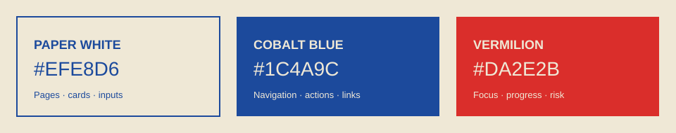
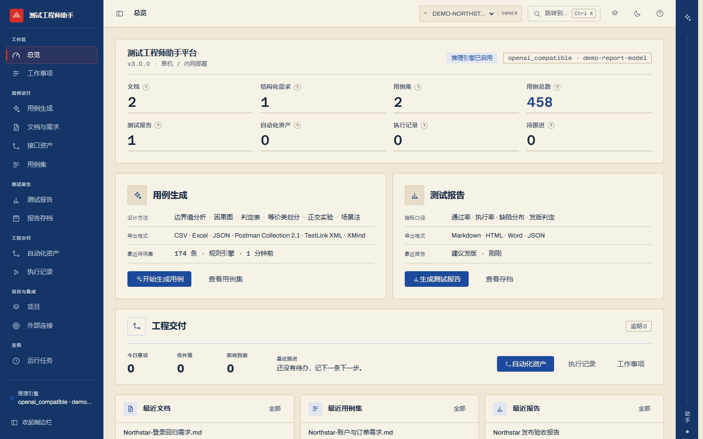
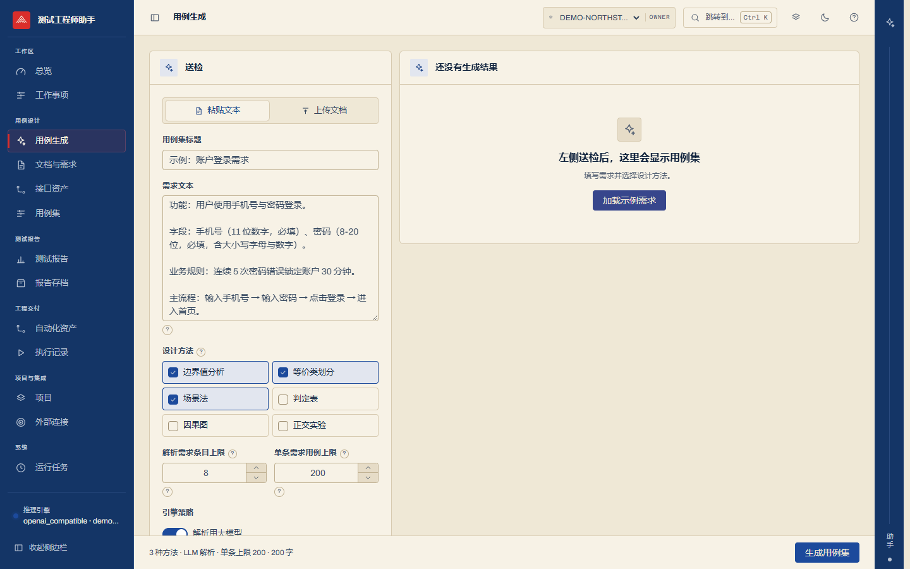
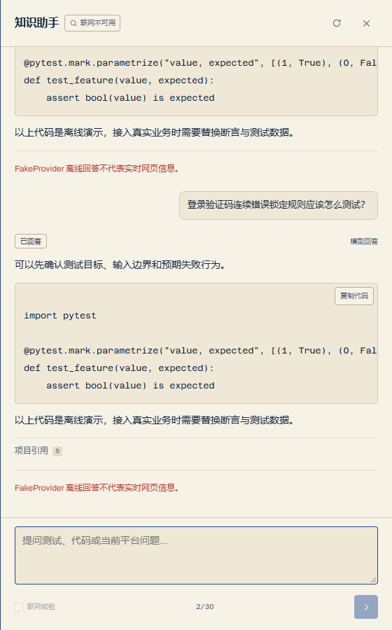
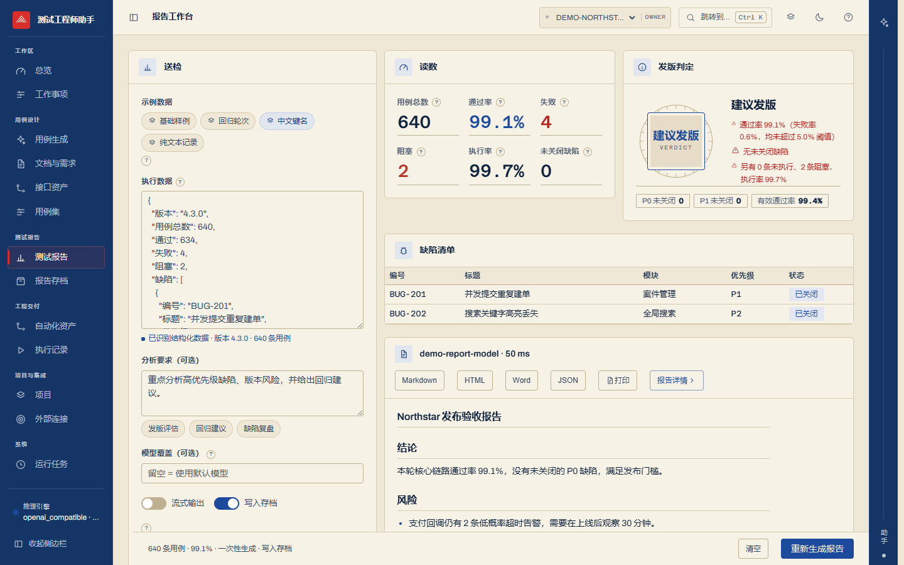

<p align="center">
  
</p>

# 设计系统

## 设计世界

**Paper & Ink Workbench** 是一个高密度测试工程工作台。纸本白承载内容，钴蓝建立结构与主操作，
猩红只标记当前位置、焦点、运行进度和风险。界面依靠平面色块、边线和紧凑排版建立层级，
不使用渐变、玻璃拟态、装饰光晕或额外的视觉主题。

## 三色系统

<p align="center">
  
</p>

| 颜色 | 色值 | 用途 |
| --- | --- | --- |
| 纸本白 | `#EFE8D6` | 页面、卡片、输入面、文档背景 |
| 钴蓝 | `#1C4A9C` | 侧栏、主操作、链接、信息状态 |
| 猩红 | `#DA2E2B` | 当前导航、焦点、运行进度、风险强调 |

规则：

- 页面主体必须是纸本白。
- 主结构、可点击操作和信息状态使用钴蓝。
- 猩红只用于当前状态和需要立即注意的内容，不作为大面积装饰。
- 状态同时使用文字、图标和形状，不依赖颜色单通道。
- 深色主题保持同一主次关系，不引入新的品牌色。

## 真实界面

以下截图来自独立临时存储、Fake 模型与合成项目数据。截图不包含真实项目、文档、报告、路径、
账号、密钥或业务数据。

### 总览



总览通过稳定导航、项目上下文、关键指标和工作域入口建立第一层信息结构。

### 用例生成



生成页把输入、方法选择、模型参与方式和执行状态放在同一条工作流中，避免流程说明占据主界面。

### 知识助手



助手支持持久对话、代码复制、状态说明和折叠引用。回答正文、事实、推断和来源分区展示。

### 测试报告



报告页先展示确定性指标与发版判定，再展示模型归纳正文，避免模型覆盖权威数字。

## 布局

```text
┌────────────┬────────────────────────────────────┬──────┐
│ 主导航      │ 顶部栏 + 工作区                     │ 助手 │
│ 可折叠      │ 高密度表格 / 表单 / 编辑面           │ 固定 │
└────────────┴────────────────────────────────────┴──────┘
```

- 桌面端左侧主导航固定，中央自适应，右侧助手栏固定。
- 顶部栏保留页面标题、项目切换、快速跳转、密度、主题和帮助。
- 移动端隐藏右侧固定轨，由顶部入口打开全屏助手。
- 页面优先横向分组、表格和分区，不把每个区块包成独立大卡片。
- 卡片只用于重复条目、模态框和真实工具容器，不使用卡片嵌套卡片。
- 页面间距采用 `4 / 8 / 12 / 16 / 24 / 32 / 48px`。

## 字体

- 中文：PingFang SC、Microsoft YaHei、Source Han Sans SC、Noto Sans SC。
- 拉丁 UI：Archivo。
- 编号、代码、指标和 trace ID：Azeret Mono。
- 正文 14px，辅助文字 12px，标签 10px。
- 页面标题 18–22px，工作区内部标题更小。
- 不使用随视口宽度缩放的字体，不使用负字距。

## 组件

### 导航

- 主导航按工作域分组。
- 当前路由使用猩红信号条和文字状态。
- 折叠后保留图标、可访问名称和 tooltip。

### 项目切换

- 始终显示当前项目 Key、名称和角色。
- 项目切换后清理旧项目上下文。
- 项目不可用时显示明确恢复动作。

### 表格

- 行高 32–38px。
- 表头使用小号标签和高对比文字。
- 使用整行 hover 和选中态，不依赖斑马纹。
- 长文本换行或截断，移动端不得产生横向溢出。

### 表单

- 输入始终有可见 label。
- 字段解释默认收成 `?`，悬停和键盘聚焦时展开。
- 二进制设置使用开关或 checkbox。
- 数值限制使用输入框、步进器或滑杆。
- 错误在字段附近显示失败对象和恢复动作。

### 提示

| 组件 | 用途 |
| --- | --- |
| `FieldHint` | 字段说明 |
| `Tip` | 术语、口径和算法解释 |
| `EmptyState` | 空状态与下一步 |
| `confirmAction` | 不可逆操作确认 |
| `NoticeHost` | 成功、警告、错误和信息通知 |

## 动效

- 路由切换：轻微上移淡入，140ms。
- 助手抽屉：横向滑入，240ms。
- 导航选中：信号条出现，160ms。
- 文档解析：猩红扫描线，完成后停止。
- 列表与表格不做统一入场动画。
- 全部动效尊重 `prefers-reduced-motion`。

## 文案

- 页面不解释自身如何工作，不重复标题，不写产品宣言。
- 标签直接说对象或动作，如 `用例集`、`生成 pytest 资产`、`导入 JUnit`、`重建索引`。
- 错误说明失败对象、影响和恢复动作。
- 空状态只保留一句下一步。
- 保留会改变判断的口径：服务端计算、人工确认、只读建议、未通过校验不可下载。

## 禁止项

- 渐变文字、渐变背景、装饰光晕、玻璃拟态。
- 卡片嵌套卡片、满屏同尺寸图标卡、装饰性左侧彩条。
- 常驻流程说明、重复面包屑、重复页面标题。
- Emoji 作为图标。
- 未经脱敏的真实业务截图。
