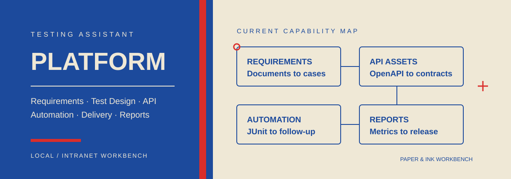
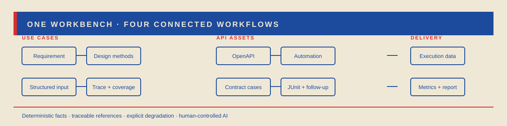

<p align="center">
  
</p>

<p align="center">
  <a href="https://github.com/Seventy7photograph/Testing-Assistant-Platform-With-AI/actions/workflows/ci.yml"></a>
  
  
  
  
  <a href="LICENSE"></a>
</p>

# 测试工程师助手平台

面向测试工程师的本地 / 内网一体化工作台。平台把需求分析、测试设计、接口资产、自动化交付、
测试报告、项目治理与知识助手放进同一个控制台，共用一套配置、存储、审计和追溯体系。

> 规则与确定性计算是主干，大模型是可降级、可追溯的增强。没有 API Key 时，需求生成与报告
> 的确定性部分仍可运行；任何降级都会在界面和响应中明确说明。

<p align="center">
  
</p>

## 当前能力

| 工作域 | 已实现能力 | 详细说明 |
| --- | --- | --- |
| 需求与用例 | 文档上传、图片识别、结构化需求、六种测试设计方法、LLM 可选复核/补缺、去重排序、需求追溯、覆盖率、变更对比、用例版本、五种导出格式 | [功能总览](docs/FEATURES.md#需求与用例) |
| 接口资产 | OpenAPI 3 JSON/YAML 导入、`$ref` 展开与循环检测、契约用例、只读 AI 复核、Postman Collection 2.1 | [功能总览](docs/FEATURES.md#接口资产) |
| 自动化交付 | 受控 `pytest + httpx` 资产、静态安全门禁、JUnit 回收、受控 HTTP 执行、失败跟进、工作事项与提醒 | [功能总览](docs/FEATURES.md#自动化交付) |
| 受控 AI 建议 | operation 缺口、失败断言、fixture/数据配方、脚本只读审查；人工采纳后才派生新资产版本 | [功能总览](docs/FEATURES.md#受控-ai-建议) |
| 测试报告 | 指标计算、发版阈值、AI 归纳、SSE 流式报告、存档、趋势对比、Markdown/HTML/DOCX/JSON 导出 | [功能总览](docs/FEATURES.md#测试报告) |
| 项目与治理 | 项目分区、可选 API Key、角色与配额、审计、Jira/禅道同步、任务与工具调用记录、模型路由 | [功能总览](docs/FEATURES.md#项目与治理) |
| 知识助手 | 项目级 FTS5 检索、持久多轮会话、测试问答、代码建议、DeepSeek Search/Fetch、引用折叠、服务端预算限制 | [功能总览](docs/FEATURES.md#知识助手) |
| 工作台 | 总览仪表盘、双主题、三档密度、批量操作、全局搜索、命令面板、右侧助手、移动端适配 | [设计与架构](docs/ARCHITECTURE.md#工作台) |

## 核心原则

- **确定性优先**：指标、阈值、用例编号、安全门禁和项目状态由服务端计算，模型不重算权威数字。
- **可追溯**：用例关联需求，执行关联资产，报告关联执行数据，知识回答关联来源、版本和定位。
- **只读边界清晰**：复核、建议、脚本审查和网页内容都不能直接改写资产或执行操作。
- **降级可见**：未配置模型、联网失败、外部连接缺失或资产未通过校验时，都返回明确原因。
- **人工控制**：自动化 AI 建议必须显式采纳后才应用；派生版本不覆盖原资产。

## 快速开始

### 1. 安装

```powershell
python -m venv .venv
.venv\Scripts\Activate.ps1
python -m pip install -U pip
pip install -r requirements-dev.txt
Copy-Item .env.example .env
```

### 2. 启动

```powershell
python run.py
```

访问：

- 工作台：`http://127.0.0.1:8000/`
- Swagger：`http://127.0.0.1:8000/docs`
- 健康检查：`http://127.0.0.1:8000/api/v1/health`

仅本机使用时建议：

```powershell
python run.py --host 127.0.0.1 --port 8000 --no-reload
```

### 3. 配置模型

```dotenv
LLM_PROVIDER=deepseek
LLM_API_KEY=your-key
LLM_BASE_URL=https://api.deepseek.com
LLM_MODEL=deepseek-flash
```

也可以在「模型设置」页运行时覆盖，保存后立即生效。完整变量见
[配置说明](docs/CONFIGURATION.md) 和 [`.env.example`](.env.example)。

### 4. 前端开发

只有修改 `frontend/**` 时需要：

```powershell
cd frontend
npm install
npm run dev
npm run build
```

构建产物写入 `app/static/`，后端会直接托管。

## 文档

| 文档 | 内容 |
| --- | --- |
| [功能总览](docs/FEATURES.md) | 当前全部功能、输入输出、边界与人工控制点 |
| [API 参考](docs/API.md) | 全部 REST 接口、响应结构、鉴权头和常用请求示例 |
| [配置说明](docs/CONFIGURATION.md) | 模型、联网、图片识别、存储、鉴权、执行和报告阈值 |
| [常见问题](docs/FAQ.md) | 启动、无 Key、模型、图片、联网、存储、自动化和提醒 |
| [架构说明](docs/ARCHITECTURE.md) | 分层、扩展点、Prompt 可信工程、项目隔离与安全边界 |
| [设计系统](DESIGN.md) | 三色系统、真实界面、布局、组件与动效 |
| [安全策略](SECURITY.md) | 数据边界、第三方模型传输、外部连接和密钥处理 |
| [贡献指南](CONTRIBUTING.md) | 开发环境、提交规范、自检与发布流程 |
| [更新日志](CHANGELOG.md) | 历史版本和迭代记录 |

## 技术栈

| 层 | 技术 |
| --- | --- |
| 后端 | Python 3.10+、FastAPI、Pydantic、SQLAlchemy、SQLite FTS5 |
| 前端 | Vue 3、TypeScript、Vite、Element Plus、Pinia |
| 模型 | DeepSeek / OpenAI 兼容端点；可选图片识别模型与本地 OCR |
| 存储 | JSON 文件或 SQLite；项目模式按 `storage/projects/<project_id>/` 隔离 |
| 测试 | pytest、前端 `vue-tsc`、Playwright 冒烟 |

## 视觉系统

<p align="center">
  
</p>

| 颜色 | 色值 | 用途 |
| --- | --- | --- |
| 纸本白 | `#EFE8D6` | 页面、卡片、输入面与文档背景 |
| 钴蓝 | `#1C4A9C` | 侧栏、主操作、链接、信息状态 |
| 猩红 | `#DA2E2B` | 当前导航、焦点、运行进度与风险强调 |

完整规则见 [设计系统](DESIGN.md)。

## 数据与部署

- 默认单机模式，数据位于 `storage/`。
- 项目模式按项目隔离文档、用例、报告、知识索引与审计。
- 对外部署前请开启 `AUTH_ENABLED`，配置 `AUTH_TOKENS`，并在反向代理层增加认证。
- 所有模型密钥只通过环境变量注入，不写入仓库。

## 许可

MIT License，见 [LICENSE](LICENSE)。
